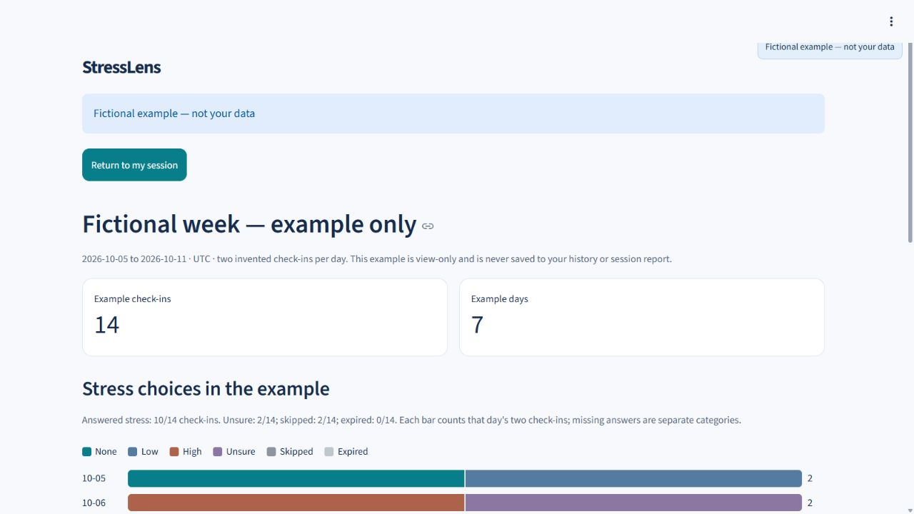

# StressLens

> **Working prototype — Stage 2 in progress**  
> **Project owner: Satyam Tomar · Status updated: 11 November 2026**

### Work time, voluntary check-ins and clear reports

I built StressLens as an AI-assisted portfolio project around a simple workday problem: keeping track of work time and recording how I feel without losing the context behind the numbers.

The result is a local Python/Streamlit prototype with a work clock, optional check-ins, break reminders and descriptive charts. The main demonstration works with the camera off.

**Python · Streamlit · pandas · Local-first demonstration**

*This is a labelled demonstration with invented answers, not participant data.*

## Take a quick look

- [Visual project brief](docs/Satyam_Tomar_StressLens.pdf): three pages covering the product, my contribution and the evidence.
- [How I worked on it](docs/PORTFOLIO.md): the problem, design choices and code/test references.
- [Run it locally](docs/SETUP.md): setup, optional components and a short demonstration.
- [Verification record](docs/VERIFICATION.md): what was checked and what remains unverified.

## What the application does

| Area | What to expect |
|---|---|
| Work session | Start, pause, resume and end a work clock; only active time counts. |
| Check-ins | Record a voluntary response and optional clarity answer. Missing and unsure answers stay visible. |
| Fictional week | Explore 14 invented check-ins over seven UTC days, isolated from the personal session. |
| Charts | See descriptive category counts with denominators. |
| Reports | Export a separate session report as JSON or readable TXT. |
| Break reminders | Choose optional prompts within the updating app. |

The fictional-week view has no export. Reports do not infer stress from facial movement or combine self-reports and device readings into a health score. Optional face/text tools are exploratory and separate from the core demonstration.

## My contribution

I defined the use case, set priorities, requested changes and reviewed the experience. Codex helped with implementation, debugging, tests and documentation. The project demonstrates that collaborative process; I do not claim to have independently written every component or trained MediaPipe or Qwen.

## Development status

| Stage | Status | Scope |
|---|---|---|
| Stage 1 — local foundation | Prototype implemented; checks recorded on 20 October 2026 | Work clock, voluntary check-ins, optional break reminders, fictional-week charts and session reports. |
| Stage 2 — refinement and validation | In progress | Improve usability and reporting, check installation reproducibility and investigate optional camera performance. |
| Future user testing | Planned | Gather voluntary feedback after the local experience and consent flow are ready. |

Stage 2 is the current development phase, not a completed release. Its remaining work includes:

- [ ] Refine the report presentation and validate the end-to-end user experience.
- [ ] Verify setup on a clean machine and document any reproducibility issues.
- [ ] Investigate optional camera throughput with aligned diagnostic measurements before choosing a fix.
- [ ] Record the results and remaining limitations before a wider prototype trial.

**Latest update — 11 November 2026:** clarified the public prototype status, project ownership and Stage 2 roadmap. This update changes documentation only; it does not claim new features, new test results or a completion date.

## Verification

On 20 October 2026, the existing development environment recorded **484 passing tests, 10 real-SDK skips and 7 passing subtests**, with Ruff clean. A separate model-free test scope from the source-only package recorded **208 passes**. These scopes overlap and their counts must not be added.

Disposable browser checks covered the camera-off journey and report exports. The original 73-file release received a separate Codex QA archive review. This presentation copy keeps all 63 frozen source/test/config/asset files unchanged and adds revised documentation. The checks, limitations and documentation-only changes are described in the [verification record](docs/VERIFICATION.md).

## Scope

This is a local portfolio prototype. Physical-camera performance, scientific stress validation and installation on a clean machine remain unverified. The optional camera-rate decline has no established cause. Session state can be lost on reload or process loss; reminders are not operating-system notifications.

No project-code license has been selected. Retain [third-party attribution](assets/ATTRIBUTION.md) and review upstream terms before reusing optional models or data.
