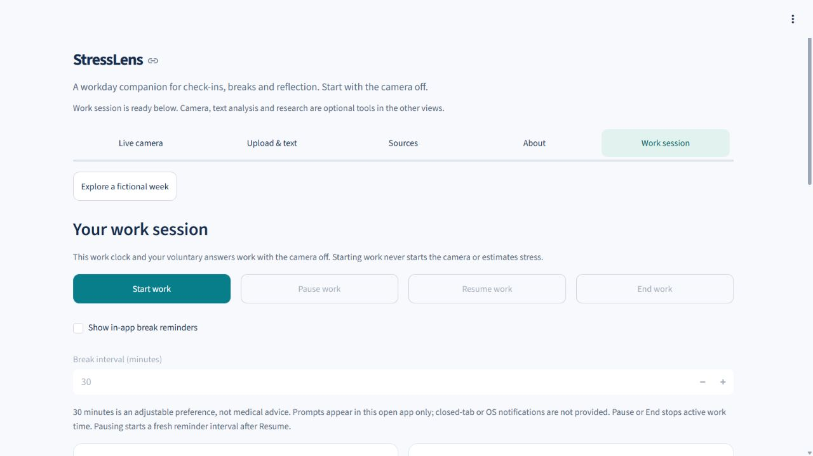
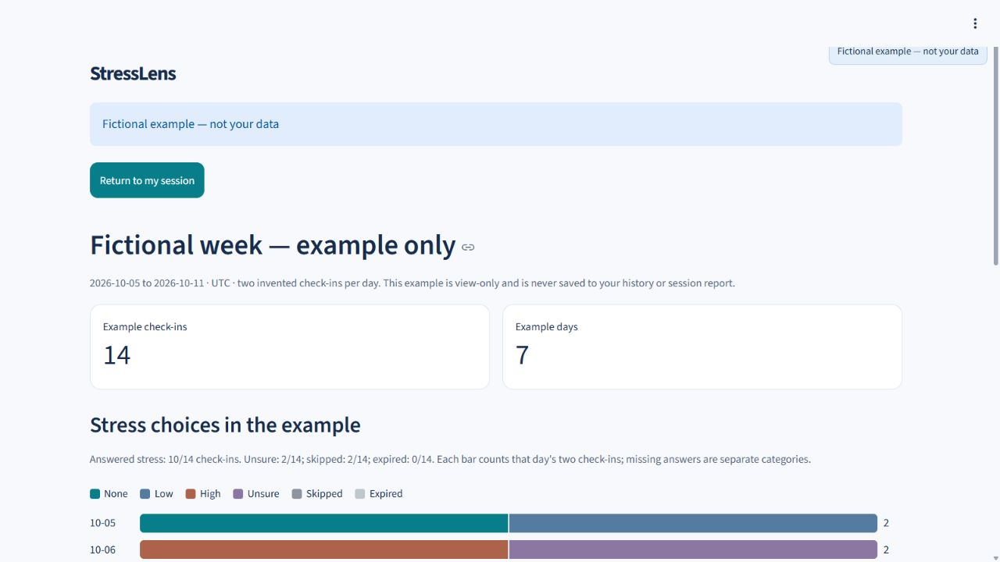
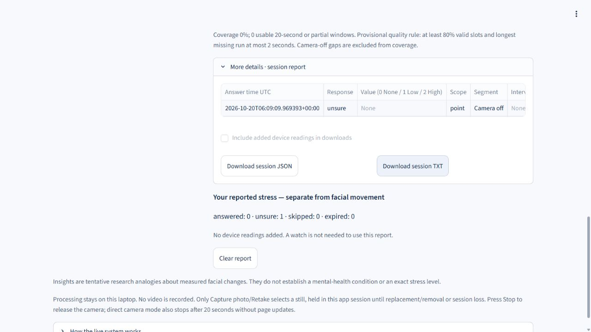

# How I worked on StressLens

**Satyam Tomar | Working prototype — Stage 2 in progress | Updated 17 November 2026**

## The problem I chose

I started with the experience of noticing mental fatigue or fogginess only after a long period of work. I wanted a laptop companion that could help me notice possible difficulties earlier and understand a session afterwards through simple graphs and a short explanation. Optional camera support and eventual automatic detection were part of that ambition.

The implemented foundation is a work clock, voluntary check-ins, reminders and descriptive reporting. These give me a usable starting point; automatic stress or fatigue detection remains unfinished and unvalidated. The [project direction](PROJECT_DIRECTION.md) keeps that longer-term aim connected to concrete next milestones.

## My role

I defined the personal use case, directed priorities, requested changes and reviewed the interface. Codex assisted with implementation, debugging, tests and documentation. I can point to the requirements and decisions I directed without claiming independent authorship of every line of code.

The decisions below describe the implemented Stage 1 prototype and the evidence behind it. Stage 2 refinement and validation are in progress; the project is not a finished production system. They are not a reconstructed commit history.

## 1. Make work time an explicit action

The Work session view has Start, Pause, Resume and End controls. The clock counts active work time; starting it does not start the camera. Reminders are optional prompts in the updating app.



*Disposable QA capture, 20 October 2026. The clock value is outside this image.*

Implementation: [WorkSession](../stresslens/wellbeing.py#L21).  
Check: [start, pause, resume and end without a camera](../tests/test_wellbeing.py#L19).

## 2. Preserve the meaning of an answer

An unsure or skipped answer is different from an answered value of zero. The stored records and category charts preserve those states. The 17 November summary correction also names unsure, skipped and expired counts in the short prose, instead of grouping them all as missing. It labels the displayed check-in scope separately from the current work clock.

The fictional week uses 14 invented check-ins across seven UTC days. It is a view-only demonstration and stays separate from personal records and the work clock.



*Invented demonstration data. This image is not evidence of user adoption or measured wellbeing.*

Implementation: [category aggregation](../stresslens/personal_patterns.py#L38), [fictional fixture](../stresslens/demo_week.py#L25).  
Checks: [answer semantics](../tests/test_wellbeing.py#L102), [fictional-view isolation](../tests/test_demo_week_ui.py#L49).

## 3. Keep sources and reports understandable

A voluntary answer, an imported device reading and a camera observation mean different things. The report keeps them separate. JSON and TXT are two representations of the same session report; the fictional-week example has no export.

CSV/manual readings are validated before they enter the report. A repeated source reading is handled differently from a conflicting reading. There is no live wearable connection.



*Fictional QA state, 20 October 2026. The report shows an unsure answer with no numeric value. This historical screenshot predates the short-summary wording correction.*

Implementation: [measurement validation](../stresslens/session_measurements.py#L71), [report export](../stresslens/session_report.py#L489).  
Checks: [JSON/TXT agreement](../tests/test_session_report.py#L324), [duplicate handling](../tests/test_session_report.py#L406), [conflict rejection](../tests/test_session_report.py#L447).

## How the pieces fit

```text
Explicit user action
    -> work-clock state or structured check-in
    -> validation and descriptive summaries
    -> charts and a separate JSON/TXT session report

Fictional example -> same summarizer -> isolated view
Optional camera/text tools -> separate exploratory paths
```

The main technologies are Python, Streamlit and pandas. Optional paths use OpenCV, MediaPipe, a text-classification baseline and local Qwen wording. Those optional components are not required to explain or demonstrate the core workday flow.

## What I would show in an interview

1. Open Work session with camera/SDK consent and history off.
2. Show the work controls and optional reminder settings.
3. Open Explore a fictional week and explain the invented answers, category counts and denominators.
4. Return to the personal session and explain why the example must not change it.
5. Point to the report schema and a check that preserves missing data.

The [setup and demo guide](SETUP.md) contains the full route. The [verification record](VERIFICATION.md) separates software checks from hardware and scientific validation.

## What I would improve next

The next product task is one understandable work-session report reached directly from Work session, with the correct session scope and active work time. Clean installation, measured camera diagnostics and voluntary usability feedback follow as distinct milestones. Automatic inference has its own research and evaluation path. See the [project direction and acceptance criteria](PROJECT_DIRECTION.md); none of these open milestones is presented as complete.

[Back to the project](../README.md)
