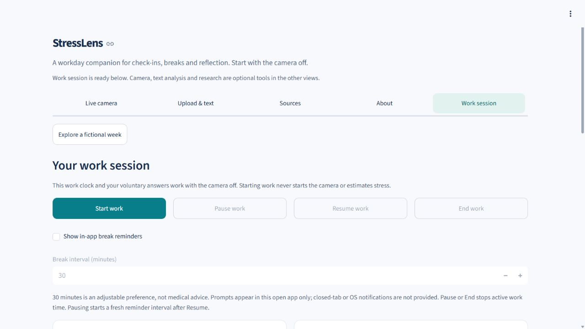
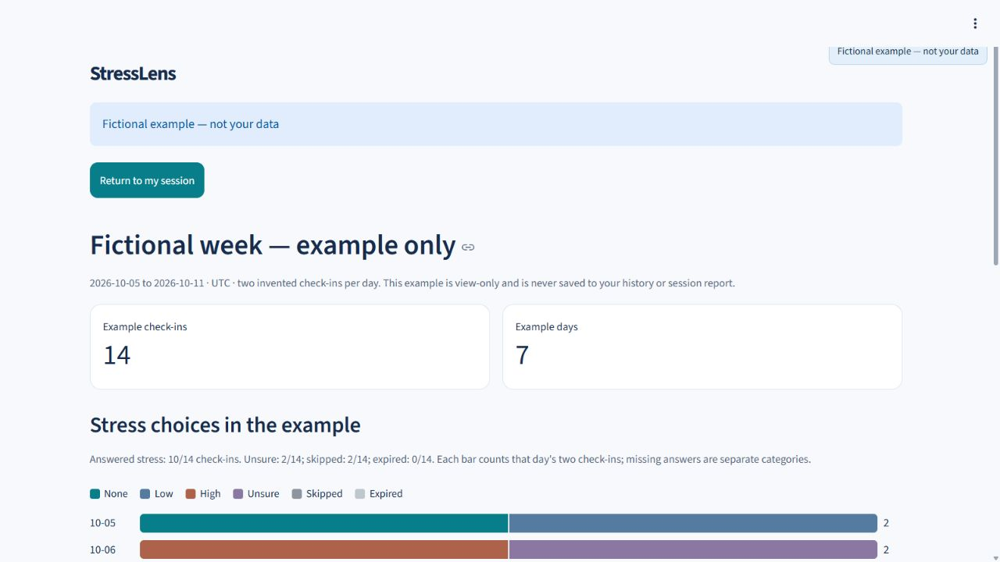
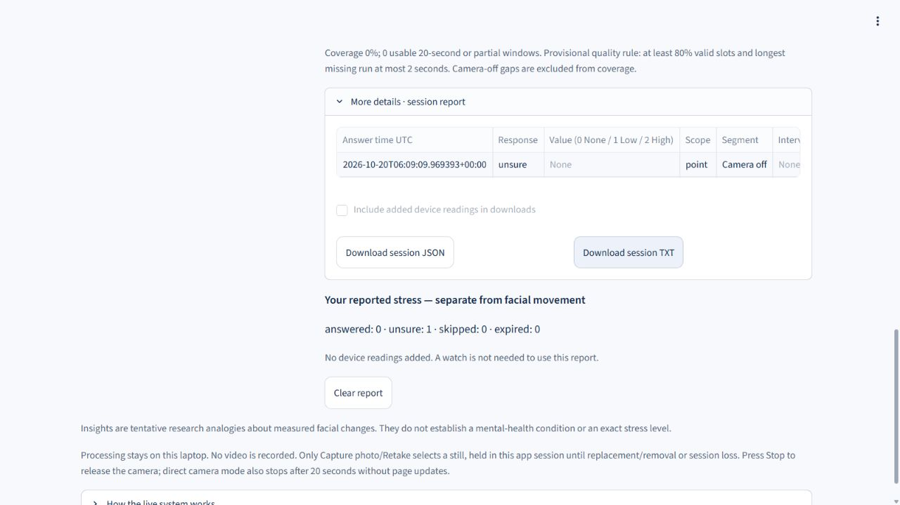

# How I worked on StressLens

**Satyam Tomar | October 2026 | AI-assisted portfolio project**

## The problem I chose

I wanted a clearer way to keep track of work time and voluntary check-ins during the day. That became a small local reporting application: a work clock, optional answers and charts that show what was actually recorded.

The useful output is a report someone can inspect and explain. The project does not establish whether a person is stressed from their face.

## My role

I defined the personal use case, directed priorities, requested changes and reviewed the interface. Codex assisted with implementation, debugging, tests and documentation. I can point to the requirements and decisions I directed without claiming independent authorship of every line of code.

The decisions below describe the finished project and the evidence behind it. They are not a reconstructed commit history.

## 1. Make work time an explicit action

The Work session view has Start, Pause, Resume and End controls. The clock counts active work time; starting it does not start the camera. Reminders are optional prompts in the updating app.



*Disposable QA capture, 20 October 2026. The clock value is outside this image.*

Implementation: [WorkSession](../stresslens/wellbeing.py#L21).  
Check: [start, pause, resume and end without a camera](../tests/test_wellbeing.py#L19).

## 2. Preserve the meaning of an answer

An unsure or skipped answer is different from an answered value of zero. The summaries retain those categories and show denominators. This makes the missing information visible instead of presenting an uninterrupted story.

The fictional week uses 14 invented check-ins across seven UTC days. It is a view-only demonstration and stays separate from personal records and the work clock.



*Invented demonstration data. This image is not evidence of user adoption or measured wellbeing.*

Implementation: [category aggregation](../stresslens/personal_patterns.py#L38), [fictional fixture](../stresslens/demo_week.py#L25).  
Checks: [answer semantics](../tests/test_wellbeing.py#L102), [fictional-view isolation](../tests/test_demo_week_ui.py#L49).

## 3. Keep sources and reports understandable

A voluntary answer, an imported device reading and a camera observation mean different things. The report keeps them separate. JSON and TXT are two representations of the same session report; the fictional-week example has no export.

CSV/manual readings are validated before they enter the report. A repeated source reading is handled differently from a conflicting reading. There is no live wearable connection.



*Fictional QA state, 20 October 2026. The report shows an unsure answer with no numeric value.*

Implementation: [measurement validation](../stresslens/session_measurements.py#L71), [report export](../stresslens/session_report.py#L489).  
Checks: [JSON/TXT agreement](../tests/test_session_report.py#L324), [duplicate handling](../tests/test_session_report.py#L406), [conflict rejection](../tests/test_session_report.py#L447).

## How the pieces fit

```text
Explicit user action
    -> work-clock state or structured check-in
    -> validation and descriptive summaries
    -> charts and a separate JSON/TXT session report

Fictional example -> same summarizer -> isolated view
Optional camera/text tools -> separate exploratory paths
```

The main technologies are Python, Streamlit and pandas. Optional paths use OpenCV, MediaPipe, a text-classification baseline and local Qwen wording. Those optional components are not required to explain or demonstrate the core workday flow.

## What I would show in an interview

1. Open Work session with camera/SDK consent and history off.
2. Show the work controls and optional reminder settings.
3. Open Explore a fictional week and explain the invented answers, category counts and denominators.
4. Return to the personal session and explain why the example must not change it.
5. Point to the report schema and a check that preserves missing data.

The [setup and demo guide](SETUP.md) contains the full route. The [verification record](VERIFICATION.md) separates software checks from hardware and scientific validation.

## What I would improve next

The optional camera-rate decline needs aligned measurements before choosing a performance fix. Clean-machine setup is another unverified scope. Neither a faster sampling rate nor a health-prediction result is promised here.

[Back to the project](../README.md)
